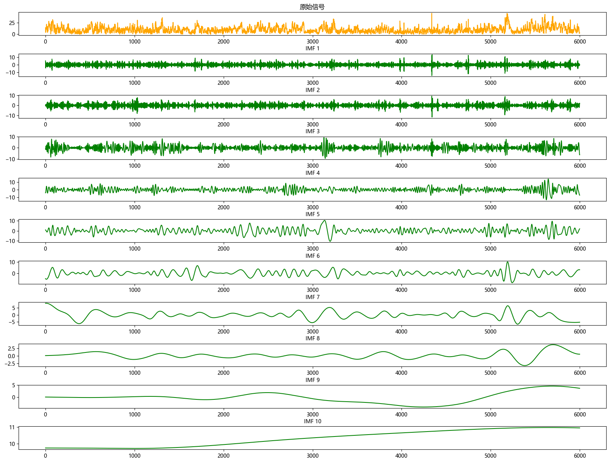
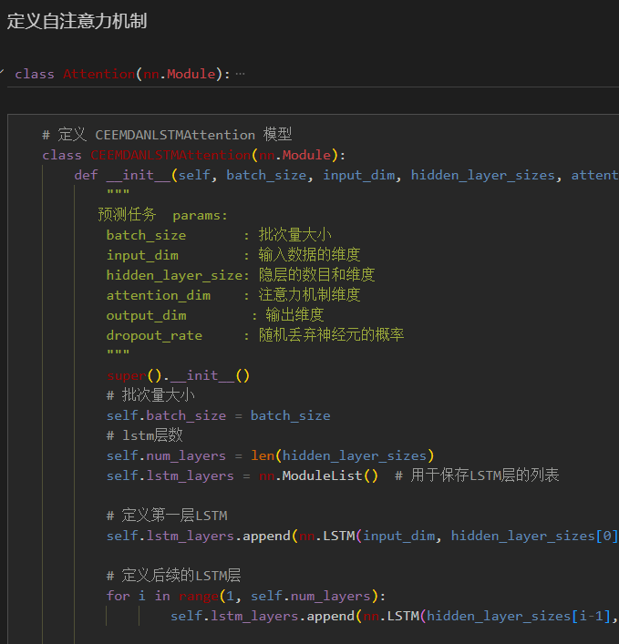
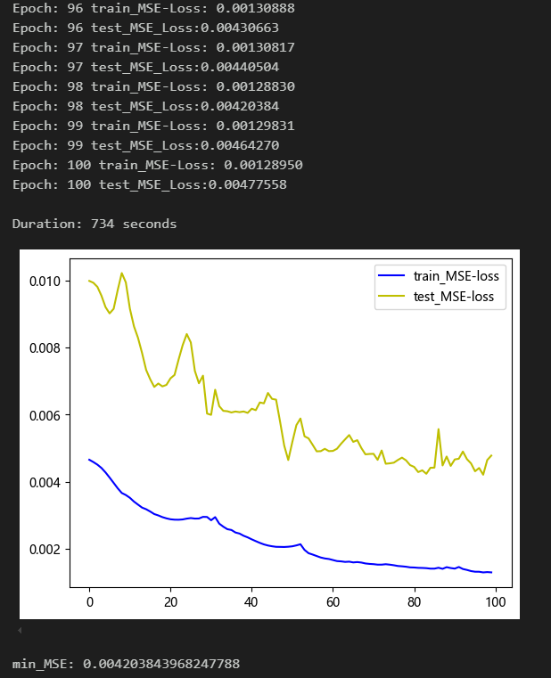
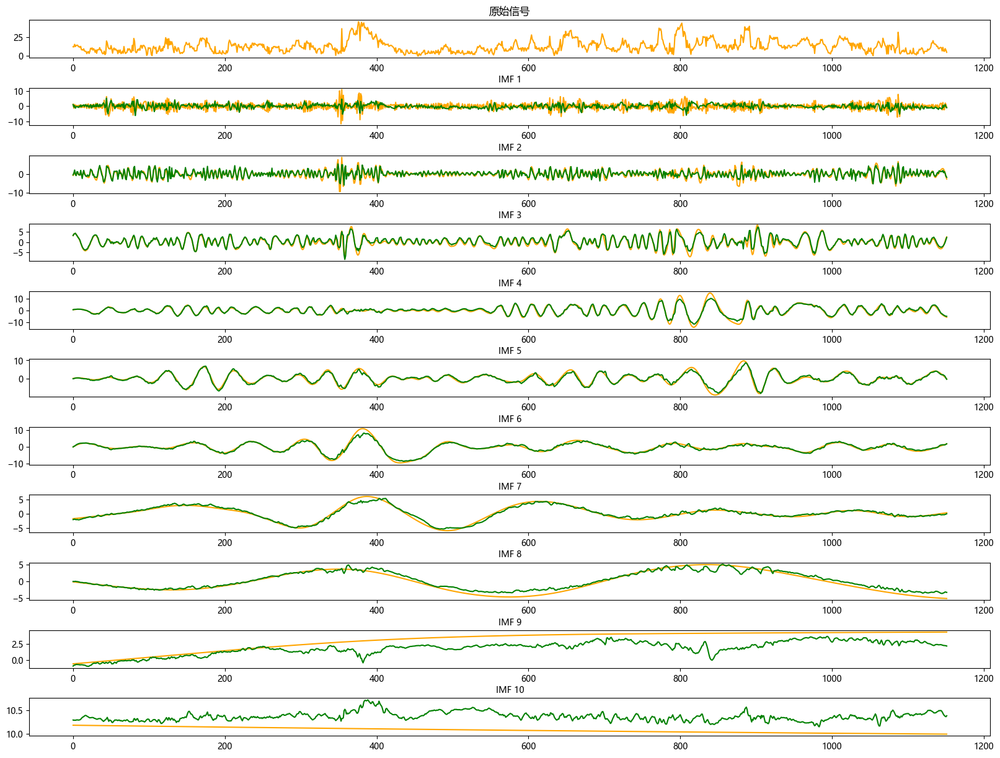
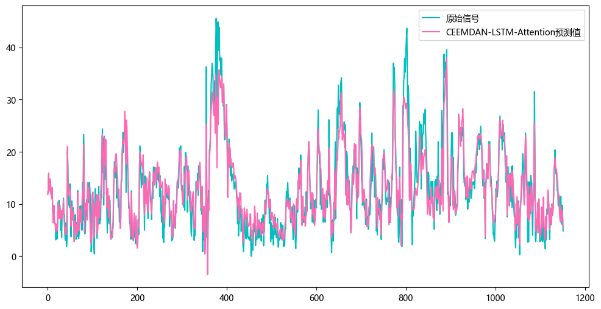
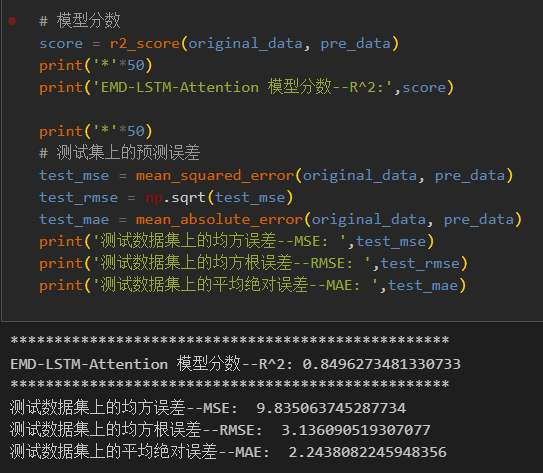
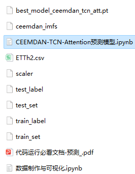

# Step-by-step Prediction of CEEMDAN-LSTM-Attention

Multi-feature variable sequences include the following:  
\n        \n  
\n        \n      \n        \n      \n        \n      \n        \n      \n        \n  
\n        \n  
Previously excellent content:  
Time series forecasting: Analysis and comparison of LSTM, ARIMA, Holt-Winters, SARIMA models  
Wind speed prediction (I) - Data introduction and preprocessing  
Wind speed prediction (II) - EMD-LSTM model based on Pytorch  
Wind speed prediction (III) - EMD-LSTM-Attention model  
Wind speed prediction (IV) - EMD-Transformer model based on Pytorch  
Wind speed prediction (V) - EMD-CNN-LSTM model based on Pytorch  
Wind speed prediction (VI) - EMD-CNN-GRU parallel model based on Pytorch  
CEEMDAN + combined forecasting model (BiLSTM-Attention + ARIMA)  
CEEMDAN + combined forecasting model (CNN-LSTM + ARIMA)  
CEEMDAN + combined forecasting model (Transformer - BiLSTM + ARIMA)  
CEEMDAN + combined forecasting model (CNN-Transformer + ARIMA)  
Multi-feature variable sequence prediction (I) - CNN-LSTM wind speed prediction model  
Multi-feature variable sequence prediction (II) - CNN-LSTM-Attention wind speed prediction model  
Multi-feature variable sequence prediction (III) - CNN-Transformer wind speed prediction model  
Multi-feature variable sequence prediction (IV) - Transformer-BiLSTM wind speed prediction model
Multi-feature variable sequence prediction (5) CEEMDAN+CNN-LSTM wind speed prediction model
Multi-feature variable sequence prediction (6) CEEMDAN+CNN-Transformer wind speed prediction model
Prediction model based on the SSA optimized by the sparrow optimization algorithm: CEEMDAN-BiLSTM-Attention
Prediction model based on the SSA optimized by the sparrow optimization algorithm: CEEMDAN-Transformer-BiGRU
Superior predictive model: Secondary decomposition-combined prediction
Multi-feature variable sequence prediction (7) CEEMDAN+Transformer-BiLSTM prediction model
Multi-feature variable sequence prediction (8) Prediction model based on the SSA optimized by the sparrow optimization algorithm: CEEMDAN-SSA-BiLSTM
Multi-feature variable sequence prediction (11) TCN-GRU prediction model based on Pytorch
VMD + CEEMDAN secondary decomposition, CNN-LSTM prediction model
VMD + CEEMDAN secondary decomposition, CNN-Transformer prediction model
Prediction model based on the SSA optimized by the sparrow optimization algorithm: code family kit

## Images

<!-- PAYMENT_BLOCK -->

## Get this dataset

- Payment link (Stripe): [Buy now](https://buy.stripe.com/3cs8yP7sY87d0vu9AB)
- Payment QR code: 

<!-- /PAYMENT_BLOCK -->
